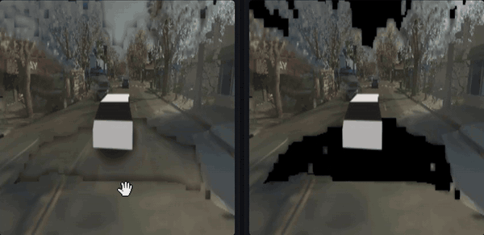

# Reality View (NuRec)

**English** | [简体中文](README.zh-CN.md)

[](https://github.com/haihan19955/reality-view-nurec/actions/workflows/ci.yml)
[](LICENSE)

An open reproduction of a "Reality View"-style ego surround view: from the six cameras of a car, render the scene
around it from **any orbit viewpoint**, including places no camera can see (under and right next to the car), in
**real time**, and let the user drag the view freely.

Everything is trained on NVIDIA NuRec neural reconstructions of real drives. The repository contains code only. NuRec
data, renders and trained weights are not distributed.

<p align="center">
  
  <br><sub>v0.1 frame model on a held-out scene. Left: generated view. Right: geometry only (black = seen by no camera).
  <a href="docs/demo.mp4">Full recording with the six input cameras</a>.</sub>
</p>

## Two approaches

| | v0.1 frame model | v0.2 video student (free view) |
|---|---|---|
| Output | one frame, any orbit view | continuous video, any orbit view, drag to move |
| Geometry | DA3 metric depth → point cloud → splat | same, accumulated over the last 2 s |
| Generator | 77M MeanFlow DiT, fills the holes | Wan2.1-1.3B + LoRA, generates the whole frame, 8 frames per chunk |
| Temporal consistency | none (per frame) | previous frame is the context of the next chunk |
| Speed (RTX 4090) | ~44 ms per view | 13–19 fps; the view follows the mouse instantly |

## v0.2: free-view video student

```
offline   NuRec teacher: 2 chase cameras + 6 random orbit tracks per scene ─▶ Difix-ref clean-up ─▶ 14.5k target frames
          Wan2.1-1.3B LoRA student (6k steps) ─▶ MeanFlow distillation: 30 sampling steps → 1

runtime   6 rig cameras + ego motion ─▶ DA3 depth ─▶ point cloud (last 2 s) ─▶ warp into the requested camera ─┐
          DINOv2 tokens of the 6 cameras ─────────────────────────────────────────────────────────────────────┤
          requested camera pose (mouse drag) ─▶ pose tokens ──────────────────────────────────────────────────┤
          previous generated frame (context) ──────────────────────▶ 1-step student ◀─────────────────────────┘
                                                                     ─▶ TAEHV decode ─▶ ego car overlay ─▶ browser
          while dragging: the last generated frame is reprojected into the new view (~25 ms), until the
          generator delivers frames from the new view (~0.6 s after release)
```

What mattered, in order:

| Step | Finding |
|---|---|
| Cross-attention conditioning only | the student hallucinates and drifts: geometry must be **pixel-aligned** |
| Point-cloud warp as input channels | zero-initialised channels stay unused; initialise them as a copy of the noisy-latent weights, 10× lr |
| Trust the warp over the previous frame | corrupt the context frame inside the observed mask; 3× loss weight on observed pixels |
| MeanFlow distillation | average-velocity targets from a few teacher Heun steps (no JVP); 30 steps → 1 |
| Free view | orbit teacher tracks (pitch 8–35°, distance 6–12 m, camera ≤ 5 m high); camera pose of frames 0/4/8 in the ego tokens |
| Real time | TAEHV tiny VAE; one-pass point-cloud splat (3.5× faster, identical output); drag preview by reprojection |

### Results

Chase view, held-out rollouts of 12 chunks (`benchmarks/student/evaluate.py`):

| Run | s / 8 frames | PSNR ↑ | SSIM ↑ | DINO sim ↑ | sharpness (teacher = 1) | flicker (teacher = 1) |
|---|---|---|---|---|---|---|
| no geometry, 30 steps | 8.3 | 18.29 | 0.615 | 0.448 | 0.53 | 0.69 |
| point-cloud warp (geo v3), 30 steps | 8.3 | 20.03 | 0.642 | 0.601 | 0.44 | 0.88 |
| + MeanFlow, 1 step | 0.9 | 20.03 | 0.639 | 0.570 | 0.36 | 0.93 |

Free-view training: validation flow-matching loss on 2 held-out scenes, by noise level t (lower is better):

| Checkpoint | chase t=0.2 | chase t=0.5 | chase t=0.8 | orbit t=0.2 | orbit t=0.5 | orbit t=0.8 |
|---|---|---|---|---|---|---|
| chase-only student (start) | 0.2726 | 0.0972 | 0.0629 | 0.3289 | 0.1445 | 0.1154 |
| free view, 6k steps | **0.2644** | **0.0925** | **0.0546** | **0.3114** | **0.1292** | **0.0876** |

Orbit views improve by up to 24% while the chase view gets better too. DINOv3-L as camera features was 1–2% worse
than DINOv2-L on every metric at equal steps, so DINOv2 stays the default (`--feat dino3` is supported).

Live viewer (RTX 4090, 832×480): 13–19 generated fps (recording: 10 fps); drag preview ~20 per second, ~30 ms round
trip; generated frames from the new view ~0.6 s after the mouse is released.

**Limitations.** Side and front views of held-out scenes are visibly blurrier than the chase view: the point cloud
covers less there and the model has to guess. Views above ~38° pitch or 5.5 m are not supported, because the NuRec
teacher cannot render them cleanly. The drag preview stretches near objects on large rotations.

## v0.1: frame model

```
6 surround RGB ─▶ DA3METRIC depth + sky mask ─▶ point cloud ─▶ z-buffer splat into the orbit camera ─┐
              └─▶ DINOv2-L tokens ─▶ camera context ─────────────────────────────────────────────────┤
                                     MeanFlow DiT, 1 step ◀──────────────────────────────────────────┘
                                     ─▶ keep real pixels, fill holes ─▶ draw ego car
```

| Method (2 held-out scenes, outside the ego zone) | PSNR (dB) |
|---|---|
| Geometry only (holes black) | 14.06 |
| MeanFlow 1-step, no geometry | 16.80 |
| MeanFlow 1-step + geometry | **18.27** |
| Composite: real pixels + MeanFlow in the holes | 18.25 (visibly sharper) |

Depth benchmark against rendered lidar (6 scenes, 144 views):

| Method | AbsRel ↓ | δ<1.25 ↑ | Novel-view PSNR | Time |
|---|---|---|---|---|
| Depth Anything V2 metric | 0.860 | 0.126 | 19.12 | 666 ms |
| **DA3METRIC** (used here) | 0.255 | 0.623 | 19.94 | 102 ms |
| DA3 with known poses, 12 frames | 0.234 | 0.665 | 20.31 | 252 ms |
| DrivingForward (zero-shot) | 0.361 | 0.427 | 19.29 | 312 ms |

## Quick start

Requirements: Linux or WSL2, a 24 GB CUDA GPU (developed on an RTX 4090), Docker with the NVIDIA Container Toolkit,
and about 60 GB of free disk for 12 scenes.

```bash
pip install -e ".[nurec,student]"
bash scripts/setup/install_da3.sh                     # Depth Anything 3 weights -> $RV_MODELS (default ~/models)
```

**v0.2 video student**, full guide with timings in [docs/video-student.md](docs/video-student.md):

```bash
bash scripts/nurec/render_all_teacher.sh              # chase teacher views, one renderer container per scene
bash scripts/nurec/render_all_orbit.sh                # + 6 orbit tracks per scene
python scripts/nurec/clean_teacher.py --fp16          # Difix-ref clean-up
python scripts/student/prepare.py                     # VAE latents, DINOv2 tokens, ego motion, camera poses
python scripts/student/prepare_warp.py                # point-cloud warps + their latents
python scripts/student/train.py --geo --free_view --init <chase student> --p_corrupt 0.5 --obs_w 2 \
    --p_drop_geo 0.1 --steps 6000 --out $RV_WORK/checkpoints/student_free
python scripts/student/distill.py --teacher $RV_WORK/checkpoints/student_free/last.pt --steps 2500 \
    --out $RV_WORK/checkpoints/student_mf_free
bash viewer/run_live.sh                               # http://localhost:8771, drag to orbit, wheel to zoom
```

**v0.1 frame model**:

```bash
python scripts/nurec/make_download_list.py 16         # NuRec links -> work/nurec_links.tsv (accept the HF terms first)
bash scripts/nurec/setup_client.sh <carla>/PythonAPI/examples/nvidia/nurec   # gRPC client stubs
bash scripts/nurec/render_all_scenes.sh               # -> work/nurec_data/
bash scripts/run_pipeline.sh 8000                     # preprocess -> train -> evaluate
python viewer/server.py --ckpt work/checkpoints/step07.5k.pt                 # http://localhost:8770
```

All data, caches, weights and outputs live in `work/` (gitignored). Override locations with `RV_WORK`, `RV_MODELS`,
`RV_CACHE`, `NUREC_SCENES`, `NUREC_DATA` and `NUREC_PROTO` (see [realityview/paths.py](realityview/paths.py)).

## Repository layout

```
realityview/              core library (pip install -e .)
  paths.py                every on-disk location, overridable by environment variables
  geometry.py             cameras, lifting, splatting, compositing, orbit cameras
  warp.py                 6-camera point cloud warp into a virtual camera (video student), hole filling
  student.py              Wan2.1 LoRA video student, ego / camera-pose conditioning
  model.py                v0.1 MeanFlow DiT
  depth.py  features.py   DA3 metric depth; DINOv2 / DINOv3 camera tokens
  latents.py dataset.py   SD VAE helpers; v0.1 dataset reader
  ego_car.py pipeline.py  ego car overlay; v0.1 RealityView pipeline
scripts/
  nurec/                  NuRec renderer: download list, dataset (v0.1), teacher + orbit tracks (v0.2), Difix clean-up
  student/                v0.2: prepare, prepare_warp, train, distill, sample
  preprocess.py train.py evaluate.py run_pipeline.sh                         v0.1 training
  setup/                  third-party installers
viewer/
  live.py live.html       v0.2 real-time free-view viewer
  server.py index.html    v0.1 viewer
benchmarks/               depth, NuRec extrapolation, video student evaluation
tools/                    cache inspection, ego car preview
```

## Roadmap

- Sharper side / front views: more orbit data, stronger point-cloud conditioning, longer training
- Better drag preview: depth-aware hole filling instead of push-pull blur
- More NuRec scenes; recover the scenes without rear cameras
- TensorRT export and higher resolution

Contributions are welcome. See [CONTRIBUTING.md](CONTRIBUTING.md) and the [changelog](CHANGELOG.md).

## Licenses and acknowledgements

Code: MIT. This project builds on [Wan2.1](https://github.com/Wan-Video/Wan2.1),
[Depth Anything 3](https://github.com/ByteDance-Seed/Depth-Anything-3), [MeanFlow](https://arxiv.org/abs/2505.13447),
[Difix3D+](https://github.com/nv-tlabs/Difix3D) (non-commercial), [TAEHV](https://github.com/madebyollin/taehv),
DINOv2 / DINOv3, [DrivingForward](https://github.com/fangzhou2000/DrivingForward) and NVIDIA NuRec / the
[PhysicalAI-Autonomous-Vehicles-NuRec](https://huggingface.co/datasets/nvidia/PhysicalAI-Autonomous-Vehicles-NuRec)
dataset. Each is subject to its own license. Check them before any use beyond research.

Not affiliated with Tesla or NVIDIA.
