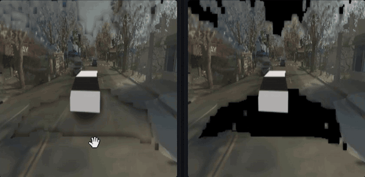

# Reality View (NuRec)

[English](README.md) | **简体中文**

[](https://github.com/haihan19955/reality-view-nurec/actions/workflows/ci.yml)
[](LICENSE)

开源复现"Reality View"式的自车环视：只用车上的 6 路相机，**实时**渲染车辆周围**任意绕车视角**的画面，
包括所有相机都看不到的地方（车底和车身两侧），并且可以用鼠标自由拖动视角。

所有模型都在 NVIDIA NuRec（真实驾驶数据的神经重建场景）上训练。本仓库只包含代码，不分发 NuRec 数据、
渲染结果和训练好的权重。

<p align="center">
  
  <br><sub>v0.1 单帧模型，训练时没见过的场景。左：生成画面。右：只有几何（黑色 = 没有任何相机看到）。
  <a href="docs/demo.mp4">带 6 路输入相机的完整录屏</a>。</sub>
</p>

## 两种方案

| | v0.1 单帧模型 | v0.2 视频学生模型（自由视角） |
|---|---|---|
| 输出 | 单帧，任意绕车视角 | 连续视频，任意绕车视角，鼠标拖动 |
| 几何 | DA3 度量深度 → 点云 → 投影 | 同左，累积最近 2 秒的点云 |
| 生成器 | 7700 万参数 MeanFlow DiT，只补空洞 | Wan2.1-1.3B + LoRA，生成整帧，每次 8 帧 |
| 时间连续性 | 无（逐帧独立） | 上一帧作为下一段的上下文 |
| 速度（RTX 4090） | 每个视角约 44 ms | 13–19 帧/秒，拖动时画面即时跟手 |

## v0.2：自由视角视频学生模型

```
离线     NuRec 教师：每个场景 2 个追尾相机 + 6 条随机绕车轨迹 ─▶ Difix-ref 清理 ─▶ 1.45 万张目标帧
         Wan2.1-1.3B LoRA 学生模型（6000 步）─▶ MeanFlow 蒸馏：30 步采样 → 1 步

运行时   6 路相机 + 自车运动 ─▶ DA3 深度 ─▶ 点云（最近 2 秒）─▶ 投影到目标相机 ────────────┐
         6 路相机的 DINOv2 特征 ───────────────────────────────────────────────────────────┤
         目标相机位姿（鼠标拖动）─▶ 位姿 token ─────────────────────────────────────────────┤
         上一帧生成画面（上下文）──────────────────────▶ 1 步学生模型 ◀───────────────────────┘
                                                        ─▶ TAEHV 解码 ─▶ 叠加自车模型 ─▶ 浏览器
         拖动过程中：把最近一帧生成画面按深度重投影到新视角（约 25 ms），
         直到生成器给出新视角的画面（松手后约 0.6 秒）
```

关键发现（按顺序）：

| 步骤 | 结论 |
|---|---|
| 只用交叉注意力注入条件 | 学生模型会幻觉、漂移：几何必须**像素对齐** |
| 点云投影作为输入通道 | 零初始化的新通道学不起来；改为复制噪声潜变量通道的权重初始化，学习率 ×10 |
| 让模型信任点云而不是上一帧 | 在可观测区域内破坏上下文帧；可观测像素的损失权重 ×3 |
| MeanFlow 蒸馏 | 用教师的几步 Heun 积分构造平均速度目标（不需要 JVP）；30 步 → 1 步 |
| 自由视角 | 绕车教师轨迹（俯仰 8–35°，距离 6–12 m，相机高度 ≤ 5 m）；把第 0/4/8 帧的相机位姿放进 ego token |
| 实时 | TAEHV 轻量 VAE；点云单次合并投影（快 3.5 倍，输出完全一致）；拖动时用重投影预览 |

### 结果

追尾视角，2 个未参与训练的场景，每次连续生成 12 段（`benchmarks/student/evaluate.py`）：

| 版本 | 秒 / 8 帧 | PSNR ↑ | SSIM ↑ | DINO 相似度 ↑ | 清晰度（教师 = 1） | 闪烁（教师 = 1） |
|---|---|---|---|---|---|---|
| 无几何，30 步 | 8.3 | 18.29 | 0.615 | 0.448 | 0.53 | 0.69 |
| 点云投影（geo v3），30 步 | 8.3 | 20.03 | 0.642 | 0.601 | 0.44 | 0.88 |
| + MeanFlow，1 步 | 0.9 | 20.03 | 0.639 | 0.570 | 0.36 | 0.93 |

自由视角训练：2 个未参与训练场景上的验证损失，按加噪程度 t 分列（越低越好）：

| 模型 | 追尾 t=0.2 | 追尾 t=0.5 | 追尾 t=0.8 | 绕车 t=0.2 | 绕车 t=0.5 | 绕车 t=0.8 |
|---|---|---|---|---|---|---|
| 只训练追尾的学生模型（起点） | 0.2726 | 0.0972 | 0.0629 | 0.3289 | 0.1445 | 0.1154 |
| 自由视角，6000 步 | **0.2644** | **0.0925** | **0.0546** | **0.3114** | **0.1292** | **0.0876** |

绕车视角最多提升 24%，追尾视角也同时变好。相同步数下，用 DINOv3-L 做相机特征在每一项上都比 DINOv2-L
差 1–2%，所以默认保留 DINOv2（`--feat dino3` 仍可使用）。

实时查看器（RTX 4090，832×480）：生成 13–19 帧/秒（录制为 10 帧/秒）；拖动预览约 20 张/秒，往返约 30 ms；
松手后约 0.6 秒换上新视角的生成画面。

**局限。** 未见过场景的侧面和车头视角明显比追尾视角模糊：点云在这些方向覆盖较少，模型只能去猜。不支持
俯仰超过约 38° 或高于 5.5 m 的视角，因为 NuRec 教师在那里渲染不出干净的画面。大角度转动时，拖动预览会把
近处物体拉长。

## v0.1：单帧模型

```
6 路环视 RGB ─▶ DA3METRIC 深度 + 天空掩码 ─▶ 点云 ─▶ z-buffer 投影到绕车相机 ─┐
            └─▶ DINOv2-L 特征 ─▶ 相机上下文 ─────────────────────────────────┤
                                 MeanFlow DiT，1 步 ◀─────────────────────────┘
                                 ─▶ 保留真实像素、补空洞 ─▶ 叠加自车模型
```

| 方法（2 个未见过场景，自车区域以外） | PSNR (dB) |
|---|---|
| 只有几何（空洞为黑） | 14.06 |
| MeanFlow 1 步，无几何 | 16.80 |
| MeanFlow 1 步 + 几何 | **18.27** |
| 合成：真实像素 + MeanFlow 补洞 | 18.25（肉眼更清晰） |

深度方法对比，以渲染的激光雷达为真值（6 个场景，144 个视角）：

| 方法 | AbsRel ↓ | δ<1.25 ↑ | 新视角 PSNR | 耗时 |
|---|---|---|---|---|
| Depth Anything V2 metric | 0.860 | 0.126 | 19.12 | 666 ms |
| **DA3METRIC**（本项目使用） | 0.255 | 0.623 | 19.94 | 102 ms |
| DA3 + 已知位姿，12 帧 | 0.234 | 0.665 | 20.31 | 252 ms |
| DrivingForward（零样本） | 0.361 | 0.427 | 19.29 | 312 ms |

## 快速开始

环境要求：Linux 或 WSL2，24 GB 显存的 CUDA GPU（开发用的是 RTX 4090），装好 NVIDIA Container Toolkit
的 Docker；12 个场景约需 60 GB 磁盘空间。

```bash
pip install -e ".[nurec,student]"
bash scripts/setup/install_da3.sh                     # Depth Anything 3 权重 -> $RV_MODELS（默认 ~/models）
```

**v0.2 视频学生模型**，带耗时的完整步骤见 [docs/video-student.md](docs/video-student.md)：

```bash
bash scripts/nurec/render_all_teacher.sh              # 渲染追尾教师视角，每个场景一个渲染容器
bash scripts/nurec/render_all_orbit.sh                # 每个场景再加 6 条绕车轨迹
python scripts/nurec/clean_teacher.py --fp16          # Difix-ref 清理
python scripts/student/prepare.py                     # VAE 潜变量、DINOv2 特征、自车运动、相机位姿
python scripts/student/prepare_warp.py                # 点云投影及其潜变量
python scripts/student/train.py --geo --free_view --init <追尾学生模型> --p_corrupt 0.5 --obs_w 2 \
    --p_drop_geo 0.1 --steps 6000 --out $RV_WORK/checkpoints/student_free
python scripts/student/distill.py --teacher $RV_WORK/checkpoints/student_free/last.pt --steps 2500 \
    --out $RV_WORK/checkpoints/student_mf_free
bash viewer/run_live.sh                               # http://localhost:8771，拖动绕车、滚轮缩放
```

**v0.1 单帧模型**：

```bash
python scripts/nurec/make_download_list.py 16         # NuRec 下载链接 -> work/nurec_links.tsv（先在 HF 上同意条款）
bash scripts/nurec/setup_client.sh <carla>/PythonAPI/examples/nvidia/nurec   # 生成 gRPC 客户端
bash scripts/nurec/render_all_scenes.sh               # -> work/nurec_data/
bash scripts/run_pipeline.sh 8000                     # 预处理 -> 训练 -> 评估
python viewer/server.py --ckpt work/checkpoints/step07.5k.pt                 # http://localhost:8770
```

所有数据、缓存、权重和输出都放在 `work/`（已加入 gitignore）。路径可以用 `RV_WORK`、`RV_MODELS`、
`RV_CACHE`、`NUREC_SCENES`、`NUREC_DATA`、`NUREC_PROTO` 覆盖（见 [realityview/paths.py](realityview/paths.py)）。

## 目录结构

```
realityview/              核心库（pip install -e .）
  paths.py                所有磁盘路径，可用环境变量覆盖
  geometry.py             相机、反投影、投影、合成、绕车相机
  warp.py                 6 路相机点云投影到虚拟相机（视频学生模型）、补洞
  student.py              Wan2.1 LoRA 视频学生模型、自车运动 / 相机位姿条件
  model.py                v0.1 MeanFlow DiT
  depth.py  features.py   DA3 度量深度；DINOv2 / DINOv3 相机特征
  latents.py dataset.py   SD VAE 工具；v0.1 数据读取
  ego_car.py pipeline.py  自车模型叠加；v0.1 RealityView 流水线
scripts/
  nurec/                  NuRec 渲染：下载列表、数据集（v0.1）、教师 + 绕车轨迹（v0.2）、Difix 清理
  student/                v0.2：prepare、prepare_warp、train、distill、sample
  preprocess.py train.py evaluate.py run_pipeline.sh                         v0.1 训练
  setup/                  第三方依赖安装
viewer/
  live.py live.html       v0.2 实时自由视角查看器
  server.py index.html    v0.1 查看器
benchmarks/               深度、NuRec 外推、视频学生模型评估
tools/                    缓存检查、自车模型预览
```

## 路线图

- 更清晰的侧面 / 车头视角：更多绕车数据、更强的点云条件、更长的训练
- 更好的拖动预览：用考虑深度的补洞代替多尺度模糊填充
- 更多 NuRec 场景；补上缺少后视相机的场景
- TensorRT 导出和更高分辨率

欢迎参与贡献，见 [CONTRIBUTING.md](CONTRIBUTING.md) 和 [更新日志](CHANGELOG.md)。

## 许可与致谢

代码采用 MIT 许可。本项目基于 [Wan2.1](https://github.com/Wan-Video/Wan2.1)、
[Depth Anything 3](https://github.com/ByteDance-Seed/Depth-Anything-3)、[MeanFlow](https://arxiv.org/abs/2505.13447)、
[Difix3D+](https://github.com/nv-tlabs/Difix3D)（非商用许可）、[TAEHV](https://github.com/madebyollin/taehv)、
DINOv2 / DINOv3、[DrivingForward](https://github.com/fangzhou2000/DrivingForward) 以及 NVIDIA NuRec /
[PhysicalAI-Autonomous-Vehicles-NuRec](https://huggingface.co/datasets/nvidia/PhysicalAI-Autonomous-Vehicles-NuRec)
数据集，它们各自有自己的许可。研究以外的用途请先确认这些许可。

与 Tesla、NVIDIA 均无关联。
